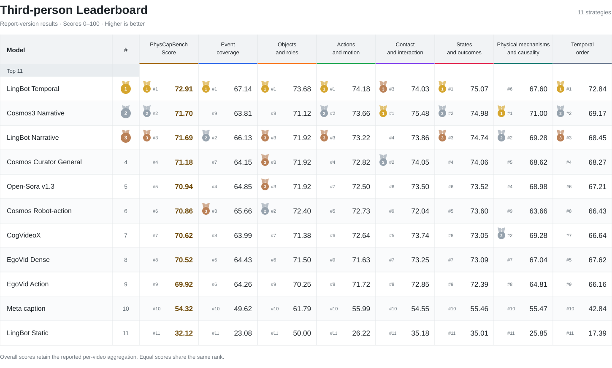
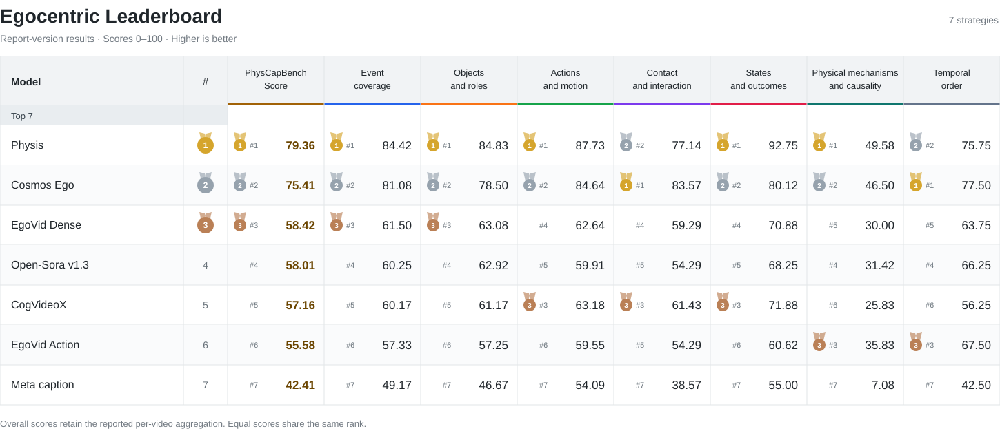

<p align="center">
  <picture>
    <source media="(prefers-color-scheme: dark)" srcset="assets/logo-dark.svg">
    
  </picture>
</p>

# PhysCapBench

**A Cross-Domain Benchmark for Physically Grounded Video Captioning**

PhysCapBench evaluates whether video captions describe physical events, objects, actions, interactions, state changes, mechanisms, and temporal relations. It contains **1,500 annotated sequences across three domains**, with one reference record per sequence.


*Overview from the tech report. The figure summarizes the research workflow and downstream studies; this repository provides the video-caption evaluation pipeline.*

| Domain | CLI name | Sequences | Input |
|---|---|---:|---|
| Third-person physical scenes | `third` | 500 | Single-view video |
| Egocentric human manipulation | `ego` | 500 | Single-view video |
| Human-operated handheld grippers | `umi` | 500 | Left-wrist / high / right-wrist composite |

The 1,500 videos total **7.43 GB** and **9.16 hours**. Every sequence has an annotation and a scoring reference.

Each UMI episode is one sample, not three. Preserve the three camera panels when generating captions. Third-person references are English, Ego references include bilingual fields, and UMI references retain their source-language fields. The text judge accepts these reference records. This caption-evaluation release provides videos and annotation text; it does not package the raw hand-tracking or gripper-trajectory arrays used during the paper’s annotation workflow.

## Leaderboard

Reported captioning-strategy results, scored from 0 to 100 (higher is better). **These are report-version results:** the evaluated subsets, references and applicable-dimension aggregation differ from the current 1,500-video release with all-seven numeric scoring. Compare results within each table; the displayed scores are not a rerun under the released protocol. Overall values are preserved from per-video aggregation, not recomputed from the seven displayed column means.

[Interactive leaderboard](https://hfwang2001.github.io/PhysCapBench/) · [Download results (JSON)](leaderboard/results.json) · [Evaluation scope and sources](leaderboard/README.md)

EC: event coverage · OR: objects and roles · AM: actions and motion · CI: contact and interaction · SO: states and outcomes · MC: mechanisms and causality · TO: temporal order.

### Third-person

[](https://hfwang2001.github.io/PhysCapBench/)

<details>
<summary>View scores as a text table</summary>

| Rank | Strategy | Overall | EC | OR | AM | CI | SO | MC | TO |
|---:|---|---:|---:|---:|---:|---:|---:|---:|---:|
| 1 | LingBot Temporal | **72.91** | **67.14** | **73.68** | **74.18** | 74.03 | **75.07** | 67.60 | **72.84** |
| 2 | Cosmos3 Narrative | 71.70 | 63.81 | 71.12 | 73.66 | **75.48** | 74.98 | **71.00** | 69.17 |
| 3 | LingBot Narrative | 71.69 | 66.13 | 71.92 | 73.22 | 73.86 | 74.74 | 69.28 | 68.45 |
| 4 | Cosmos Curator General | 71.18 | 64.15 | 71.92 | 72.82 | 74.05 | 74.06 | 68.62 | 68.27 |
| 5 | Open-Sora v1.3 | 70.94 | 64.85 | 71.92 | 72.50 | 73.50 | 73.52 | 68.98 | 67.21 |
| 6 | Cosmos Robot-action | 70.86 | 65.66 | 72.40 | 72.73 | 72.04 | 73.60 | 63.66 | 66.43 |
| 7 | CogVideoX | 70.62 | 63.99 | 71.38 | 72.64 | 73.74 | 73.05 | 69.28 | 66.64 |
| 8 | EgoVid Dense | 70.52 | 64.43 | 71.50 | 71.63 | 73.25 | 73.09 | 67.04 | 67.62 |
| 9 | EgoVid Action | 69.92 | 64.26 | 70.25 | 71.72 | 72.85 | 72.39 | 64.81 | 66.16 |
| 10 | Meta caption | 54.32 | 49.62 | 61.79 | 55.99 | 54.55 | 55.46 | 55.47 | 42.84 |
| 11 | LingBot Static | 32.12 | 23.08 | 50.00 | 26.22 | 35.18 | 35.01 | 25.85 | 17.39 |

</details>

### Egocentric

[](https://hfwang2001.github.io/PhysCapBench/)

<details>
<summary>View scores as a text table</summary>

| Rank | Strategy | Overall | EC | OR | AM | CI | SO | MC | TO |
|---:|---|---:|---:|---:|---:|---:|---:|---:|---:|
| 1 | Physis | **79.36** | **84.42** | **84.83** | **87.73** | 77.14 | **92.75** | **49.58** | 75.75 |
| 2 | Cosmos Ego | 75.41 | 81.08 | 78.50 | 84.64 | **83.57** | 80.12 | 46.50 | **77.50** |
| 3 | EgoVid Dense | 58.42 | 61.50 | 63.08 | 62.64 | 59.29 | 70.88 | 30.00 | 63.75 |
| 4 | Open-Sora v1.3 | 58.01 | 60.25 | 62.92 | 59.91 | 54.29 | 68.25 | 31.42 | 66.25 |
| 5 | CogVideoX | 57.16 | 60.17 | 61.17 | 63.18 | 61.43 | 71.88 | 25.83 | 56.25 |
| 6 | EgoVid Action | 55.58 | 57.33 | 57.25 | 59.55 | 54.29 | 60.62 | 35.83 | 67.50 |
| 7 | Meta caption | 42.41 | 49.17 | 46.67 | 54.09 | 38.57 | 55.00 | 7.08 | 42.50 |

</details>

Handheld-gripper results are not yet reported in this snapshot.

## Install

Python 3.10+ is required. Scoring needs an OpenAI-compatible text API; a GPU is not required. Install FFmpeg separately for the optional caption-generation example (`brew install ffmpeg` on macOS, or `sudo apt-get install ffmpeg` on Ubuntu).

```bash
git clone https://github.com/hfwang2001/PhysCapBench.git
cd PhysCapBench
python3 -m venv .venv
source .venv/bin/activate
python -m pip install -r requirements.lock.txt
python -m unittest discover -s tests -v
```

## Download the data

Download the [dataset on Hugging Face](https://huggingface.co/datasets/hfwang01/PhysCapBench) using the immutable revision below. The downloader also saves the source provenance and data terms.

```bash
python bench.py download --repo hfwang01/PhysCapBench --revision 4b1872201558c6fb5e231f5be2b843ed16b2e105 --videos downloaded
python bench.py validate
```

Downloads verify the metadata against `dataset.lock.json` and every video against its byte size and SHA-256. Rerunning resumes existing verified downloads. Use `--domain third`, `--domain ego`, or `--domain umi` to download one domain. Metadata always covers the complete 1,500 samples.

```text
data/
  manifest.jsonl       # IDs, domain, video paths, sizes, SHA-256, duration and views
  annotations.jsonl    # Original full-field annotation text
  references.jsonl     # Current scoring reference for each sample
  supplements.jsonl    # Bilingual corrections/additions and evidence pointers
  applicability.jsonl  # Frozen per-dimension reference evidence
  provenance.jsonl     # Source identifiers and per-video terms
  LICENSE.md           # Data redistribution and attribution terms

downloaded/videos/
  third/physcap9k_00012.mp4
  ego/egodex500_0001.mp4
  umi/umi500_0001.mp4
```

`references.jsonl` is authoritative for scoring. Original annotations are retained for provenance; the supplement records document corrections. One full-reference replacement corrects an erroneous object identification. Do not concatenate an obsolete reference with its replacement.

## Generate captions

Run your caption model on the downloaded videos without giving it reference annotations. Save a JSONL file with exactly one non-empty caption for every evaluated video:

```json
{"video_id":"physcap9k_00012","caption":"Your model's description of the visible events."}
```

Create an ID-complete template:

```bash
python bench.py template --out predictions.jsonl
```

For a domain subset, pass `--domain ego` consistently to template, validation and scoring. Missing/extra IDs, duplicate IDs and empty captions are rejected.

The optional generator samples eight uniform frames. It is a minimal integration example, not an official captioning baseline; sparse sampling can miss short interactions, and resizing a UMI composite can obscure wrist details.

```bash
export OPENAI_API_KEY='YOUR_KEY'
export OPENAI_BASE_URL='https://YOUR-VISION-ENDPOINT/v1'
python bench.py generate --model YOUR_VISION_MODEL --videos downloaded --out predictions.jsonl
```

## Evaluate

Use the configured judge model and endpoint for comparable results. The default is `doubao-seed-2-1-pro-260628` at the Ark endpoint. A different `--model` or endpoint is an alternative evaluator and must be reported.

```bash
export OPENAI_API_KEY='YOUR_JUDGE_KEY'
export OPENAI_BASE_URL='https://ark.cn-beijing.volces.com/api/v3'
python bench.py validate --predictions predictions.jsonl
python bench.py score --predictions predictions.jsonl --out results/my_model
```

The seven dimensions are:

1. Event coverage
2. Objects and roles
3. Actions and motion
4. Contact and interaction
5. States and outcomes
6. Physical mechanisms and causality
7. Temporal order

Every dimension receives an integer score from 0 to 100. The overall score is the equal mean of seven dimensions within each video, followed by the equal mean across videos. The output also reports domain summaries.

Only dimensions with insufficient reference evidence receive an additional `confidence` value in [0,1]. Supported dimensions omit it. There are 48 such cells across 46 samples in this release. Confidence does not alter scoring weights and is not an eighth dimension or calibrated probability. Where there is no basis for a directional judgment, the declared fallback is score 50 and confidence 0. Candidate omissions do not make a sufficiently annotated dimension insufficient.

```json
{
  "action_motion": {"score":85,"reason_zh":"动作描述一致。"},
  "mechanism_causality": {"score":50,"confidence":0,"reason_zh":"参考不足，采用中性约定值。"}
}
```

Outputs include `scores.jsonl`, `summary.json`, per-sample `scores/` and `applicability/` receipts, and `run.lock.json`. Evidence flags are frozen against exact reference and protocol hashes. Identical runs reuse valid checkpoints; changed captions, reference files, protocol or judge configuration require a new output directory.

**Protocol version:** this release uses revised references and all-seven numeric aggregation. The report's historical tables used their stated reference snapshots and applicable-dimension aggregation. Those tables are not results for this revised release; do not compare them as an identical benchmark protocol. The score measures reference agreement and coverage, rather than independently verifying every claim against the source video.

## Quick end-to-end test

The following uses the same Ark model exercised in our live integration test for generation and judging. Set an API key with access to that model. Use the same domain and limit throughout:

```bash
export OPENAI_API_KEY='YOUR_ARK_API_KEY'
export OPENAI_BASE_URL='https://ark.cn-beijing.volces.com/api/v3'
python bench.py download --repo hfwang01/PhysCapBench --revision 4b1872201558c6fb5e231f5be2b843ed16b2e105 --domain ego --limit 3 --videos smoke_videos
python bench.py generate --domain ego --limit 3 --videos smoke_videos --model doubao-seed-2-1-pro-260628 --out smoke_predictions.jsonl
python bench.py validate --domain ego --limit 3 --predictions smoke_predictions.jsonl
python bench.py score --domain ego --limit 3 --predictions smoke_predictions.jsonl --out results/smoke_ego
```

Repeat for `third` and `umi`. A three-sample test is not a complete domain evaluation. See [VALIDATION.json](VALIDATION.json) for integration checks, not paper benchmark scores: a fresh Python 3.11 environment downloaded and hash-verified all 1,500 videos over HTTP; all annotation/reference pairs passed validation; three real videos per domain (nine total) completed caption generation, live scoring, and checkpoint-resume tests. All 1,500 published Hugging Face video objects match their expected sizes and SHA-256 values. Three videos per domain and all seven metadata files were additionally downloaded from revision `4b1872201558c6fb5e231f5be2b843ed16b2e105` without authentication and passed validation.

## Paper assets

The README overview is exported directly from `figures/physcapbench_overview.pdf` in the Overleaf tech report. Additional figure and table inventory is documented in `docs/paper_assets.md`. Historical result plots are not displayed as results of this release.

## Publication and license

Evaluation code is provided under the [MIT license](LICENSE). Benchmark-authored annotations and metadata are CC BY 4.0; source videos and reproduced source material retain their original terms. See [data sources and terms](docs/data_sources.md). The complete video collection is subject to non-commercial research restrictions from some upstream sources.

Data: [hfwang01/PhysCapBench](https://huggingface.co/datasets/hfwang01/PhysCapBench). Code: [hfwang2001/PhysCapBench](https://github.com/hfwang2001/PhysCapBench).
