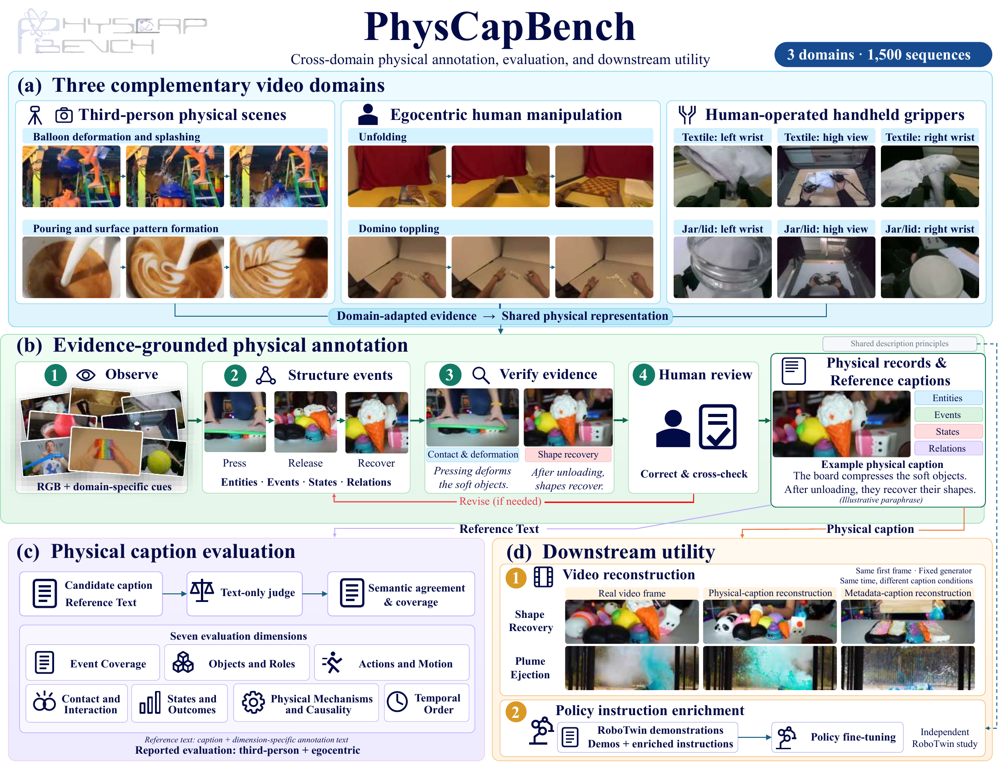

# PhysCapBench

**A Cross-Domain Benchmark for Physically Grounded Video Captioning**

PhysCapBench evaluates whether video captions describe physical events, objects, actions, interactions, state changes, mechanisms, and temporal relations. It contains **1,500 annotated sequences across three domains**, with one reference record per sequence.



*Overview from the tech report. The figure summarizes the research workflow and downstream studies; this repository provides the video-caption evaluation pipeline.*

| Domain | CLI name | Sequences | Input |
|---|---|---:|---|
| Third-person physical scenes | `third` | 500 | Single-view video |
| Egocentric human manipulation | `ego` | 500 | Single-view video |
| Human-operated handheld grippers | `umi` | 500 | Left-wrist / high / right-wrist composite |

Each UMI episode is one sample, not three. Preserve the three camera panels when generating captions. Third-person references are English, Ego references include bilingual fields, and UMI references retain their source-language fields. The text judge accepts these reference records.

## Install

Python 3.10+ is required. Scoring needs an OpenAI-compatible text API; a GPU is not required. Install FFmpeg separately for the optional caption-generation example (`brew install ffmpeg` on macOS, or `sudo apt-get install ffmpeg` on Ubuntu).

```bash
python3 -m venv .venv
source .venv/bin/activate
python -m pip install -r requirements.lock.txt
python -m unittest discover -s tests -v
```

## Download the data

The dataset repository and immutable revision will be inserted after the Hugging Face upload has been verified. This checkout is a release candidate; the commands below intentionally use placeholders until publication.

```bash
python bench.py download --repo HF_OWNER/PhysCapBench --revision DATASET_COMMIT --videos downloaded
python bench.py validate
```

Downloads verify the metadata against `dataset.lock.json` and every video against its byte size and SHA-256. Rerunning resumes existing verified downloads. Use `--domain third`, `--domain ego`, or `--domain umi` to download one domain. Metadata always covers the complete 1,500 samples.

```text
data/
  manifest.jsonl       # IDs, domain, video paths, sizes, SHA-256, duration and views
  annotations.jsonl    # Original full-field annotation text
  references.jsonl     # Current scoring reference for each sample
  supplements.jsonl    # Bilingual corrections/additions and evidence pointers
  applicability.jsonl  # Frozen per-dimension reference evidence

downloaded/videos/
  third/physcap9k_00012.mp4
  ego/egodex500_0001.mp4
  umi/umi500_0001.mp4
```

`references.jsonl` is authoritative for scoring. Original annotations are retained for provenance; the supplement records document corrections. One full-reference replacement corrects an erroneous object identification. Do not concatenate an obsolete reference with its replacement.

## Generate captions

Run your caption model on the downloaded videos without giving it reference annotations. Save a JSONL file with exactly one non-empty caption for every evaluated video:

```json
{"video_id":"physcap9k_00012","caption":"Your model's description of the visible events."}
```

Create an ID-complete template:

```bash
python bench.py template --out predictions.jsonl
```

For a domain subset, pass `--domain ego` consistently to template, validation and scoring. Missing/extra IDs, duplicate IDs and empty captions are rejected.

The optional generator samples eight uniform frames. It is a minimal integration example, not an official captioning baseline; sparse sampling can miss short interactions, and resizing a UMI composite can obscure wrist details.

```bash
export OPENAI_API_KEY='YOUR_KEY'
export OPENAI_BASE_URL='https://YOUR-VISION-ENDPOINT/v1'
python bench.py generate --model YOUR_VISION_MODEL --videos downloaded --out predictions.jsonl
```

## Evaluate

Use the configured judge model and endpoint for comparable results. The default is `doubao-seed-2-1-pro-260628` at the Ark endpoint. A different `--model` or endpoint is an alternative evaluator and must be reported.

```bash
export OPENAI_API_KEY='YOUR_JUDGE_KEY'
export OPENAI_BASE_URL='https://ark.cn-beijing.volces.com/api/v3'
python bench.py validate --predictions predictions.jsonl
python bench.py score --predictions predictions.jsonl --out results/my_model
```

The seven dimensions are:

1. Event coverage
2. Objects and roles
3. Actions and motion
4. Contact and interaction
5. States and outcomes
6. Physical mechanisms and causality
7. Temporal order

Every dimension receives an integer score from 0 to 100. The overall score is the equal mean of seven dimensions within each video, followed by the equal mean across videos. The output also reports domain summaries.

Only dimensions with insufficient reference evidence receive an additional `confidence` value in [0,1]. Supported dimensions omit it. There are 48 such cells across 46 samples in this release. Confidence does not alter scoring weights and is not an eighth dimension or calibrated probability. Where there is no basis for a directional judgment, the declared fallback is score 50 and confidence 0. Candidate omissions do not make a sufficiently annotated dimension insufficient.

```json
{
  "action_motion": {"score":85,"reason_zh":"动作描述一致。"},
  "mechanism_causality": {"score":50,"confidence":0,"reason_zh":"参考不足，采用中性约定值。"}
}
```

Outputs include `scores.jsonl`, `summary.json`, per-sample `scores/` and `applicability/` receipts, and `run.lock.json`. Evidence flags are frozen against exact reference and protocol hashes. Identical runs reuse valid checkpoints; changed captions, reference files, protocol or judge configuration require a new output directory.

**Protocol version:** this release uses revised references and all-seven numeric aggregation. The report's historical tables used their stated reference snapshots and applicable-dimension aggregation. Those tables are not results for this revised release; do not compare them as an identical benchmark protocol. The score measures reference agreement and coverage, rather than independently verifying every claim against the source video.

## Quick end-to-end test

Use the same domain and limit throughout:

```bash
python bench.py download --repo HF_OWNER/PhysCapBench --revision DATASET_COMMIT --domain ego --limit 3 --videos smoke_videos
python bench.py generate --domain ego --limit 3 --videos smoke_videos --model YOUR_VISION_MODEL --out smoke_predictions.jsonl
python bench.py validate --domain ego --limit 3 --predictions smoke_predictions.jsonl
python bench.py score --domain ego --limit 3 --predictions smoke_predictions.jsonl --out results/smoke_ego
```

Repeat for `third` and `umi`. A three-sample test is not a complete domain evaluation. See `VALIDATION.json`: a fresh Python 3.11 environment downloaded and hash-verified all 1,500 videos over HTTP; all annotation/reference pairs passed validation; three real videos per domain (nine total) completed caption generation, live scoring, and checkpoint-resume tests. Public Hugging Face download verification remains pending.

## Paper assets

The README overview is exported directly from `figures/physcapbench_overview.pdf` in the Overleaf tech report. Additional figure and table inventory is documented in `docs/paper_assets.md`. Historical result plots are not displayed as results of this release.

## Publication and license

Public dataset/repository links and license terms are pending final publication configuration. No source-video redistribution license is inferred from a dataset name. Until those fields are resolved, this directory remains a release candidate.
